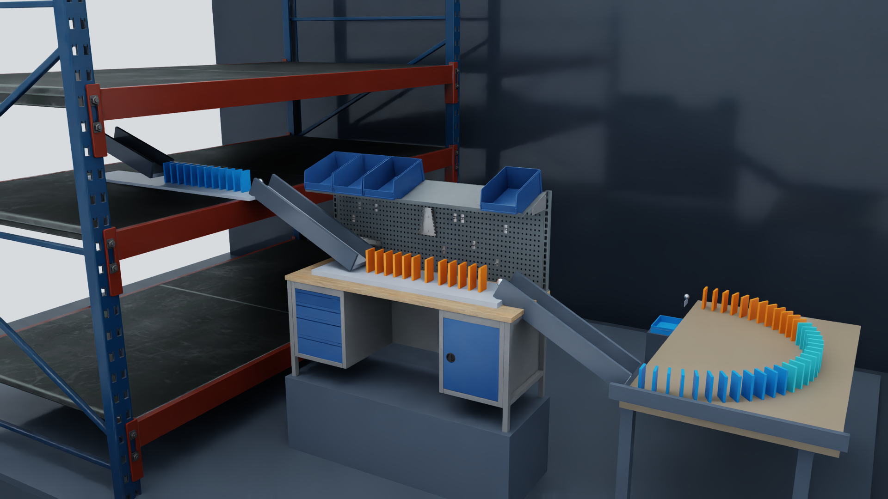

# SimScene

**Describe a scene. Find assets online. Build, simulate, and film it.**

SimScene gives AI agents tools to discover simulation assets, compose editable
USD scenes, run Isaac Sim, and improve the result from real images and physical
observations. It connects online asset selection to scene creation and video
delivery through MCP and reusable agent skills.

[Asset catalog](docs/asset-catalog.md) · [中文快速开始](docs/快速开始.md) · [Plugin setup](docs/packaging.md) · [Examples](#examples) · [Apache-2.0](LICENSE)



[Watch the V2 kinetic gallery (66s)](docs/media/kinetic-asset-gallery-1080p30.mp4) · [Watch the chain reaction](docs/media/chain-workshop-1080p30.mp4) · [Watch the sorting workshop](docs/media/precision-workshop-1080p30.mp4)

## What you can build

| Capability | What SimScene provides |
| --- | --- |
| Online asset discovery | Natural-language NVIDIA USD Search, asset inspection, previews, and Hugging Face repository discovery. |
| On-demand acquisition | Fetch selected assets and dependencies into a bounded cache on the simulation host. No full asset library download is required. |
| Editable composition | USD scenes, measured placement, support relationships, materials, lights, cameras, and reusable scene recipes. |
| Physical interaction | Isaac Sim execution, state and contact observations, and checks against a case defined before the run. |
| Simulation films | Native camera recording, editable camera plans, video editing, and frame-level source tracking. |
| Agent workflows | An MCP server plus skills for building scenes and delivering simulation videos. |

The project has completed a stage covering online asset composition, physical
interaction validation, and multi-camera film delivery, with reusable production
tools. A token advantage across tasks remains to be validated in real use.

## Get started

Python **3.10+** is required. Running simulations also requires a compatible
**NVIDIA Isaac Sim** installation on a GPU host. Install FFmpeg for video capture
and editing; see [video setup](docs/视频交付.md) for encoding requirements.

```bash
git clone https://github.com/ros-claw/simscene.git
cd simscene
python3 -m venv .venv
. .venv/bin/activate
python -m pip install -e . usd-core

simscene configure --isaac-python /absolute/path/to/isaac-sim/python.sh
simscene doctor
simscene search 'industrial conveyor'
```

Search returns candidates and metadata. After choosing a result, inspect it and
acquire only the selected files:

```bash
simscene inspect 'ASSET_URL_FROM_SEARCH'
simscene acquire 'ASSET_URL_FROM_SEARCH'
```

The default service is [NVIDIA USD Search](https://search.simready.omniverse.nvidia.com).
Set `USD_SEARCH_API_URL` to use another endpoint. Check each asset's dependency
status and license before use. Downloaded models and textures are not bundled
with this repository.

## V2 catalog and preparation

The V2 development line is **0.2.0.dev1** (plugin **0.2.0-dev.1**). It adds
unified metadata search, immutable preparation plans, persistent preparation jobs,
role-based scene recipes and optional isolated Sand3D generation. See the
[source registry](docs/assets/SOURCES.md) and [measured validation scope](docs/validation/catalog-capabilities.md).

```bash
simscene catalog sources
simscene catalog search 'notebook' --source abo-glb --limit 4
simscene recipe list
```

Search retrieves metadata; selecting and preparing a model is a separate step.
Default sources are NVIDIA USD Search, ABO and GSO. Explicit optional providers
cover a reviewed native USD manifest, a selected BOM package, configured HDRI
IDs and Central metadata locators. Asset licenses, dependency completeness and
physical suitability are checked individually. Source admission does not
certify every model.

For imported dynamic objects, use the prepared package's actual body mapping
and verify contacts, movement and settling. The [gravity-cell example](examples/catalog_gravity_cell/README.md)
provides a complete selected-asset route. [Preparation](docs/asset-catalog.md),
[scene recipes](docs/scene-recipes.md), and [optional generation](docs/asset-generation.md)
describe setup and reuse. Existing asset and simulation tools remain compatible.

## Connect your agent

Run the MCP server from the installed environment:

```bash
simscene mcp
```

For an MCP client that accepts a JSON server configuration:

```json
{
  "mcpServers": {
    "simscene": {
      "command": "/absolute/path/to/simscene/.venv/bin/python",
      "args": ["-m", "simscene.cli", "mcp"]
    }
  }
}
```

Use the [build-scene](skills/build-scene/SKILL.md) skill to discover assets,
compose a scene, run it, and inspect the result. Use
[deliver-scene-video](skills/deliver-scene-video/SKILL.md) to plan cameras and
produce traceable films. [Packaging and installation](docs/packaging.md) covers
portable, Claude Code, and DeepSeek Harness integration.

Try a prompt such as:

> Build a small workshop with a conveyor, collection bins, and a camera that
> clearly shows the handoff. Find suitable assets online, inspect their scale
> and dependencies, run the scene, and improve it from the observations.

## Examples

| Example | Explore |
| --- | --- |
| Only one sugar cube | [Editable whole-home experiment](examples/whole_home_sugar/README.md) · [55-second film](docs/media/only-one-sugar-public-55s.mp4) · [Red-rope control](docs/media/red-rope-causal-comparison-20s.mp4) |
| Multi-source kinetic gallery | [Editable recipe](examples/kinetic_asset_gallery/README.md) · [66-second film](docs/media/kinetic-asset-gallery-1080p30.mp4) |
| Cross-catalog gravity cell | [Locked assets, physical case and reproduction](examples/catalog_gravity_cell/README.md) |
| Three-level chain reaction | [Editable recipe and reproduction steps](examples/three_level_chain/README.md) · [Film](docs/media/chain-workshop-1080p30.mp4) |
| Precision sorting workshop | [Scene recipe](examples/precision_sorting_corner/README.md) · [Film](docs/media/precision-workshop-1080p30.mp4) |
| Maintenance workbench | [Scene recipe](examples/maintenance_workbench/README.md) · [Film](docs/media/maintenance-workbench-1080p30.mp4) |

Recipes preserve the selected asset references and scene operations. Acquire the
referenced assets on your own simulation host and use the example's case to
check a new run.

## Remote simulation

The MCP service can run on a GPU workstation while assets, USD files, and caches
stay on that host. Clients receive images, state, and video data. For the
experimental HTTP transport, bind through an SSH tunnel as described in the
[remote setup guide](docs/快速开始.md#远程仿真). A local SSH tunnel has been tested;
cross-machine deployment still needs validation in the target environment.

## Documentation

- [Quick start / 快速开始](docs/快速开始.md)
- [Plugin packaging and installation](docs/packaging.md)
- [Cameras, video, and layout](docs/视频交付.md)
- [Validation scope](docs/validation.md)
- [Repository contents and asset distribution](docs/开源发布说明.md)
- [Contributing](CONTRIBUTING.md)

SimScene is a development project. Scene plans and successful worker exits need
physical verification against the intended task. Robot following and collision
checks are experimental; their measured scope is described in the validation
documentation.

## License

SimScene code is licensed under [Apache-2.0](LICENSE). Third-party assets retain
their own terms; see [NOTICE](NOTICE).
