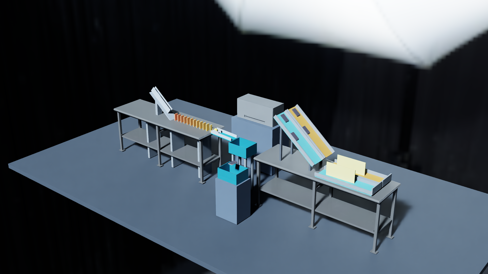

# SimScene

**Describe a scene. Find assets online. Build, simulate, and film it.**

SimScene gives AI agents an MCP server and reusable skills for discovering
assets, composing editable USD scenes, running NVIDIA Isaac Sim, and producing
videos from real simulation recordings. Agents can inspect images, measured
motion, and contacts to check and improve a scene.

**Current public preview:** [v0.2.0-dev.1](https://github.com/ros-claw/simscene/releases/tag/v0.2.0-dev.1)
· [Supported asset sources](#supported-asset-sources)
· [Get started](#get-started)
· [Connect your agent](#connect-your-agent)
· [中文快速开始](docs/快速开始.md)
· [Examples](#examples)



[Kinetic gallery · 66s](docs/media/kinetic-asset-gallery-1080p30.mp4)
· [Whole-home chain reaction · 55s](docs/media/only-one-sugar-public-55s.mp4)
· [Three-arm sorting workshop](docs/media/precision-workshop-1080p30.mp4)

## What you can build

| Capability | What the agent can use |
| --- | --- |
| Find assets online | NVIDIA USD Search, a source-aware metadata catalog, previews, and Hugging Face repository discovery. |
| Acquire selected models | Download a chosen model and its dependencies into a bounded cache on the simulation host. |
| Compose editable scenes | Measured placement, explicit support regions, materials, lights, cameras, and parameterized recipes. |
| Run physical experiments | Isaac Sim jobs, native body/joint observations, contacts, and checks against a case fixed before the run. |
| Deliver simulation videos | Native camera capture, camera plans, editing, and mappings from output frames back to recorded runs. |
| Reuse successful work | Two agent skills, editable examples, persistent preparation jobs, and optional template-based generation. |

**You do not need to download a whole asset library to search it.** Catalog
search reads bounded metadata and keeps preview loading separate. After selection, the simulation
host downloads the required model, materials, and dependencies. A remote client
can receive images and results while those files remain on the GPU host.

## Supported asset sources

The public preview registers **7 sources: 5 enabled and 2 audited**. Three are
searched by default. Optional sources require explicit selection.

| Resource | Source ID | Availability | Supported route and recorded scope |
| --- | --- | --- | --- |
| [NVIDIA USD Search](https://search.simready.omniverse.nvidia.com) | `nvidia-usd-search` | Default · enabled | Natural-language metadata search and selected native USD acquisition. The recorded workbench uses visual geometry with an explicit support proxy; its unresolved individual license blocks the newer preparation route. |
| [ABO GLB](https://huggingface.co/datasets/codepawl/abo-glb) | `abo-glb` | Default · enabled | Community-converted Amazon Berkeley Objects: metadata search and selected standard GLB preparation. A notebook has recorded rigid-body fall, contact, and settling checks. |
| [GSO GLB](https://huggingface.co/datasets/codepawl/scanned-objects-glb) | `gso-glb` | Default · enabled | Community-converted Google Scanned Objects: metadata search and selected standard GLB preparation. A scanned box has a real drop test and missing-support control. |
| [NVIDIA USDCraft-10K](https://huggingface.co/datasets/nvidia/USDCraft-10K) | `usdcraft` | Optional · enabled | Manifest search and selected native USD dependencies. The recorded `ds_R021_02` cabinet preserves a two-link, single-hinge articulation; arbitrary multi-DOF imports are outside this public profile. |
| [Poly Haven](https://polyhaven.com) | `polyhaven` | Optional · enabled | Configured HDRI/material IDs and selected resolutions. A 1k HDRI has light-only USD preparation and rendering evidence; material-map acquisition does not imply geometry preparation. |
| [NVIDIA SimReady Central](https://huggingface.co/spaces/nvidia/simready-central) | `simready-central` | Optional · audited | Literal filename filtering through its HTTP service. Returns metadata locators; this adapter does not directly acquire or prepare the returned assets. |
| [ProjectSim SimReady packages](https://huggingface.co/datasets/projectsim/simready-assets) | `projectsim-public` | Optional · audited | The selected `industrial_pipe_valve` BOM package has acquisition, visual-only preparation, texture rendering, and cache-restore evidence. Its original dynamics and joints are not qualified. |

**Enabled** means an adapter has a finite integration example. **Audited** is a
limited admission state, not full-source support. Search availability, preparation,
and physical success are separate results; each recorded check applies to its
listed asset, parameters, and runtime.

For the current development checkout, the
[packaged registry](src/simscene/catalog/data/sources.yaml) is authoritative.
Its generated [full source list](docs/assets/SOURCES.md) records revisions,
license scope, examples, and limitations. See also
[measured capabilities](docs/validation/catalog-capabilities.md) and
[adding a source](docs/assets/ADDING_A_SOURCE.md).

```bash
simscene catalog sources
simscene catalog search 'notebook' --source abo-glb --limit 4
simscene catalog search 'cabinet' --source usdcraft --limit 4
```

Hugging Face discovery finds **candidate repositories**; it does not automatically
register them or certify their models. NVIDIA USD Search and SimReady Central
are distinct services, not interchangeable names for an asset dataset. Neither
implies that every Hugging Face model is indexed or ready for physics.

### Optional generation

[Sand3D integration](docs/asset-generation.md) runs the shipped
`guide_plate_v1` and `open_receiver_v1` templates in a separately configured
environment. Generated assets enter the same preparation and physical-check
workflow. This is a generation backend, not another downloadable asset library;
it does not execute arbitrary code returned by search.

## Get started

### Development branch

Build and install the current dev2 portable package using
[the package guide](docs/packaging.md). Then run the
[one-object first delivery](examples/first_delivery/README.md) to search for a
pinned GSO scan, drop it onto an editable worktop, verify the run and export a
four-second native video. See the [integration results](docs/validation/integration-release-matrix.md)
for tested cases and client qualification scope.


### 1. Search metadata first

Use **Python 3.10+** and pin the public preview. These catalog commands do not
start Isaac Sim or require the optional GLB decoder:

```bash
git clone --branch v0.2.0-dev.1 https://github.com/ros-claw/simscene.git
cd simscene
python3 -m venv .venv
. .venv/bin/activate
python -m pip install -e .

simscene catalog sources
simscene catalog search 'notebook' --source abo-glb --limit 4
simscene recipe list
```

The first query may fetch a bounded metadata index. It does not download the
model library. For a prebuilt installation, the
[preview release](https://github.com/ros-claw/simscene/releases/tag/v0.2.0-dev.1)
includes a Python wheel and a **Linux x86_64 / Python 3.10** client bundle;
see [installation and relocation](docs/packaging.md).

### 2. Prepare one object and run a small physical test

| Operation | Additional requirements |
| --- | --- |
| Local USD inspection and scene export | Compatible host USD Python bindings. |
| Physical simulation and native rendering | A compatible NVIDIA Isaac Sim installation and GPU host. |
| Selected ABO/GSO GLB preparation | Configured Isaac asset converter, pinned Node.js decoder, and a successful `simscene asset probe`. |
| Native recording and video editing | Configured capture settings and FFmpeg/ffprobe with H.264 encoding and `zscale` support. |
| Sand3D generation | Its separate reviewed runtime; optional for all other workflows. |

The recorded catalog/preparation runtime is **Isaac Sim 6.2.0-rc.14**, OpenUSD
**0.25.11**, on Linux/RTX A6000. Other versions need their own compatibility
check; configuring a launcher path alone does not establish compatibility.

```bash
python -m pip install usd-core
simscene configure --isaac-python /absolute/path/to/isaac-sim/python.sh
simscene doctor
```

Install host USD bindings in the SimScene environment and verify compatibility
with your target runtime. Follow
[preparation setup](docs/asset-catalog.md#configure-the-preparation-runtime-explicitly)
to configure the decoder and probe the runtime before GLB physics.
`doctor` checks configuration; `asset probe` starts the preparation runtime and
records its capabilities.

**Recommended first experiment:** the
[cross-catalog gravity cell](examples/catalog_gravity_cell/README.md).
Its reproduction starts with a pinned ABO notebook and an NVIDIA table, then
checks fall, contact, and settling before expanding to several notebook
instances. The table uses a separate legacy acquisition route with an unresolved
individual license and explicit proxy limits; review the example before
acquiring its assets. Other selected-object evidence, including GSO, is listed
in the [capability matrix](docs/validation/catalog-capabilities.md).

For the existing native USD route:

```bash
simscene search 'industrial conveyor'
simscene inspect 'ASSET_URL_FROM_SEARCH'
simscene acquire 'ASSET_URL_FROM_SEARCH'
```

The default endpoint is NVIDIA USD Search; `USD_SEARCH_API_URL` selects another
compatible endpoint. Review the chosen asset's license and dependencies.
This legacy `search` command requests inline previews by default; use catalog
search for the metadata-only route. Downloaded models and textures are not
bundled with SimScene.

## Connect your agent

Run the MCP server from the installed environment:

```bash
simscene mcp
```

For a client that accepts an `mcpServers` configuration:

```json
{
  "mcpServers": {
    "simscene": {
      "command": "/absolute/path/to/simscene/.venv/bin/python",
      "args": ["-m", "simscene.cli", "mcp"]
    }
  }
}
```

| Client | Integration | Recorded public-preview evidence |
| --- | --- | --- |
| Codex | Portable package, matching skills, optional explicit MCP registration | Two authenticated tasks covering native video/physics and imported GLB preparation/physics. |
| Claude Code | Claude plugin layout and matching skills | Packaged stdio and host skill/MCP loading; no authenticated Claude model task claimed. |
| DeepSeek Harness | MCP overlay plus skill-directory configuration | Packaged stdio, overlay loading, and tool listing; no authenticated DeepSeek model task claimed. |
| Other MCP clients | Stdio configuration | Compatibility depends on the client; complete tasks need their own validation. |

See [packaging and client setup](docs/packaging.md) for the exact installation,
registration, environment-forwarding, and DeepSeek relocation steps, and
[release qualification](examples/catalog_benchmark/results/release-qualification.json)
for the scoped Codex results. Package loading is distinct from completing a
new scene-building task.

MCP registration and skill installation are separate steps. Install the matching
skills with the portable installer's project option, or use your client's skill
mechanism. Set runtime paths and decoder configuration in the environment that
actually launches the MCP server; an export in another terminal may not reach it.

The two skills divide the work:

- [build-scene](skills/build-scene/SKILL.md): select assets, prepare roles,
  compose a scene, run it, and inspect physical observations.
- [deliver-scene-video](skills/deliver-scene-video/SKILL.md): plan cameras,
  inspect native footage, and export a traceable film.

Start with a small request:

> Reproduce the gravity-cell example with its pinned ABO notebook and documented
> table acquisition route. Prepare the notebook as a rigid body and run the
> fall/contact/settling check.
> Enable native capture, inspect the actual result, and deliver the editable scene, a short native
> video, and the verification result. Download only the selected dependencies.

Then try a composition task:

> Build a small workshop with a conveyor and collection bins. Find suitable
> assets online, check their scale and dependencies, leave the working areas
> clear, and choose a camera that shows the handoff. Run the scene and improve
> it from the physical observations and images.

## Examples

| Example | What it explores | Recipe and video |
| --- | --- | --- |
| Only one sugar cube | An editable whole-home chain reaction with a separate red-rope control | [Recipe](examples/whole_home_sugar/README.md) · [55s film](docs/media/only-one-sugar-public-55s.mp4) · [20s control](docs/media/red-rope-causal-comparison-20s.mp4) |
| Multi-source kinetic gallery | Several asset roles in one scene; scheduled cabinet motion is identified separately from the passive chain | [Recipe](examples/kinetic_asset_gallery/README.md) · [66s film](docs/media/kinetic-asset-gallery-1080p30.mp4) |
| Cross-catalog gravity cell | Selected asset preparation, physical checks, and reproducible inputs | [Recipe and checks](examples/catalog_gravity_cell/README.md) |
| Three-level chain reaction | A multi-level physical scene | [Recipe](examples/three_level_chain/README.md) · [Film](docs/media/chain-workshop-1080p30.mp4) |
| Precision sorting workshop | Incremental asset and camera layout for an existing compatible three-arm scene | [Incremental recipe](examples/precision_sorting_corner/README.md) · [Film](docs/media/precision-workshop-1080p30.mp4) |
| Maintenance workbench | Industrial asset composition | [Recipe](examples/maintenance_workbench/README.md) · [Film](docs/media/maintenance-workbench-1080p30.mp4) |

Examples retain selected asset references and editable operations. Acquire the
referenced files on your simulation host and check each new run against its
case. A previous example's pass is not reused as a new scene's physical verdict.

## Remote simulation

Run MCP on a GPU workstation and keep assets, USD files, and caches there.
Clients receive images, state, and video data. The experimental HTTP transport
can use an SSH tunnel; see the [remote guide](docs/快速开始.md#远程仿真).
A local tunnel has been tested; deployment between separate machines still
needs validation in the target environment.

## Validation and current limits

- Validation is tied to selected assets, preparation profiles, physical cases,
  and recorded environments. Source admission does not certify a whole dataset.
- The public imported-articulation profile admits a canonical two-link,
  single-DOF hinge/slider. Robot following and collision checks remain experimental.
- A successful worker exit, a prepared asset, and a verified physical result
  are separate outcomes. Native recording checks are also separate from visual review.
- No cross-task token or time advantage has been established. See the
  [measured evaluation and limitations](docs/validation/catalog-efficiency.md).

The [validation guide](docs/validation.md) and
[catalog capability matrix](docs/validation/catalog-capabilities.md) describe
the actual checks and their scope.

## Documentation and contributing

- [中文快速开始](docs/快速开始.md)
- [Catalog and asset preparation](docs/asset-catalog.md)
- [Full source registry](docs/assets/SOURCES.md) · [Add a source](docs/assets/ADDING_A_SOURCE.md)
- [Scene recipes](docs/scene-recipes.md) · [Optional generation](docs/asset-generation.md)
- [Cameras and video delivery](docs/视频交付.md)
- [Plugin packaging and installation](docs/packaging.md)
- [Repository contents and asset distribution](docs/开源发布说明.md)
- [Contributing](CONTRIBUTING.md)

## License

SimScene code is licensed under [Apache-2.0](LICENSE). Third-party assets retain
their own terms and attribution requirements; see [NOTICE](NOTICE),
[source notices](OPEN_SOURCE_NOTICES.md), and the per-source records.
