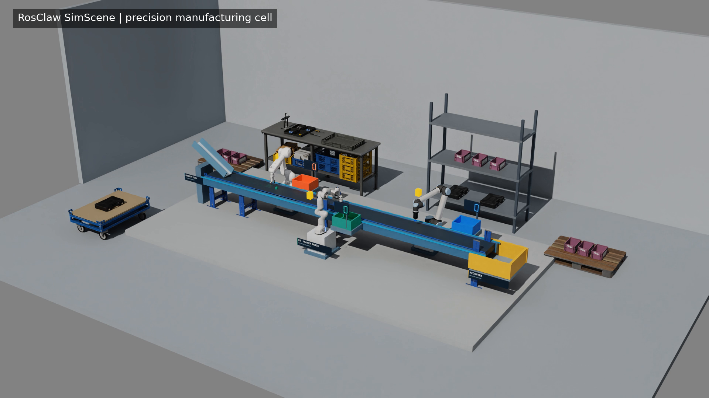

# SimScene (development)

The new [three-level chain film](docs/media/chain-workshop-1080p30.mp4) shows
64 passive bodies, six handoffs and a 36-tile semicircular wave. A fresh agent
built it with frozen tools after two earlier rounds exposed asset dependency
defects. Three clean starts, paired removal controls and a raised-table / shifted-tray
repair passed independent checks. The editable project also completed a full
replay. See the [challenge report](SIMSCENE_三层连锁工坊挑战报告_20261031.md),
[public recipe](examples/three_level_chain/README.md) and
[selected evidence](evidence/chain-workshop-1031/public/README.md).


This development version implements NVIDIA USD Search access, on-demand asset
and dependency acquisition, editable scenes, an MCP agent interface, and Isaac
simulation. The 6.2 three-arm physical suite, paired negative controls and
fresh-agent scene composition have passed. Route-swap and separately frozen
edit-repair cases have also passed; the original strict retime and first
relocation failures remain documented. Cross-machine remote execution has not
yet been verified.

Native simulation video capture is configurable through the scene: 1080p30,
optics, renderer readback, recording budgets and per-frame physics provenance.
Imported assets support measured placement on explicit support regions, grids,
alignment and selective materials. The `deliver-scene-video` skill and generic
presentation/export/inspection tools share the existing simulation pipeline.
See [视频交付与布局接口](docs/视频交付.md), the editable
[precision workshop recipe](examples/precision_sorting_corner/README.md), and the
[empty-scene maintenance recipe](examples/maintenance_workbench/README.md).

The enriched workshop passed its unchanged nine-item physical case and full
discrete audit. A separate empty-scene workbench passed three measured drops
using frozen tools and skills. This reuse test used the same active agent.
Watch the native [88-second workshop film](docs/media/precision-workshop-1080p30.mp4)
and [28-second workbench film](docs/media/maintenance-workbench-1080p30.mp4).
The workshop film labels its two separately recorded close-up sources; its 9/9
claim belongs to the complete main run. Details and limitations are in the
[视觉升级实施报告](SIMSCENE_视觉升级实施报告_20261030.md).

中文使用说明：[快速开始](docs/快速开始.md)。
交付工程和实录：[deliverables](deliverables/README.md)。
中文实施报告与复盘：[首版实施报告](SIMSCENE_V1_实施报告与项目复盘_20261030.md)。
公开仓库的安装与证据分发范围：[开源发布说明](docs/开源发布说明.md)。



[Original first-version demonstration](docs/media/triarm-demo.mp4).
Downloaded robot geometry, textures and the full workstation evidence archive
are excluded from Git; selected validation summaries and CPU test recordings
are indexed in [evidence/README.md](evidence/README.md).

```sh
python3 -m pip install -e '.[ik]' usd-core
simscene doctor
simscene configure --isaac-python /absolute/path/to/isaac-sim/python.sh
simscene search 'industrial conveyor'
simscene inspect 'ASSET_URL_FROM_SEARCH'
simscene acquire 'ASSET_URL_FROM_SEARCH'
simscene mcp
simscene build --spec scene.yaml --output scene.usda
simscene import-scene --spec scene.yaml --scene SCENE_ID
simscene run --scene SCENE_ID --steps 120
simscene verify --type domino --run evidence/domino-probe.json --case tests/fixtures/domino_case.json
```

`configure` stores non-secret defaults in the user's SimScene config directory;
environment variables override them. It does not register or install a host
plugin. `doctor` reports discovered candidate Isaac installations as well as
the configured runtime.

`run` uses a scene ID already saved in `SIMSCENE_HOME` and waits for the
worker. `--seed` records and initializes Python and NumPy random generators;
it does not promise bitwise deterministic GPU physics or change an already
authored scene. `--case PATH` snapshots and hashes an independent JSON or YAML
acceptance case before the run; `verify-lock` detects later changes to that
snapshot. `verify` reads recorded evidence and an independent JSON or YAML case;
parallel and stream cases also require `--spec` with the saved run spec.
`verify-suite --case CASE --run RUN17 --run RUN29 --run RUN43 --long-run
RUN_LONG` is a conservative gate for the documented physical trials. It
requires a case snapshotted before each run, distinct model hashes, reset and
resource evidence, measured routing, and discrete collision-audit evidence.
The audit checks every recorded physics step and modelled collision shape under
the fixed case's mechanical and grasp exceptions; it is not a continuous
swept-volume or physical-robot safety certification. The frozen 6.2 four-run
physical suite and paired negative controls have passed; agent checks are separate.
An experimental `--archive-verified-objects` option requires a snapshotted
stream case and records a terminal event before removing a settled object.
The checker re-examines its recorded contact, placement and stability evidence
and includes it in the generated-object denominator. Actual Isaac diagnostics
include an 18-object run in `evidence/three-arm-stream18-stronggrip/`;
the earlier 6.0.1 direct-belt suite achieved 59/60 in each of three seeds,
with a separate 800-second simulated run. A 6.2 run using individually acquired
online robot assets and a physical feeder placed all 18 items correctly and
passed its fixed case and discrete collision audit; its recorded demonstration
is in `evidence/isaac-6.2-online-feeder-concurrent/`. The same 6.2 feeder
arrangement has also passed its frozen multi-seed physical suite and paired
negative controls; the independent agent checks are separate.

Hugging Face tools can discover dataset repositories, list USD paths and
acquire a selected USD at a full commit SHA with resolvable dependencies.
Discovery is repository search, not a semantic index of every 3D asset.

The public gateway is the default. Set `USD_SEARCH_API_URL` or use
`--search-url` to choose another. Credentials may be supplied through
`USD_SEARCH_API_TOKEN`, or `USD_SEARCH_API_USERNAME` and
`USD_SEARCH_API_PASSWORD`. Search hits are unverified candidates. Inspection
reports errors per endpoint. Acquisition stores selected assets in a local
cache; `--cache` and `--max-bytes` override its location and capacity.
Acquisitions share a cache lock, evict older packages when needed, and clean
abandoned download staging files on the next acquisition.
For supported HTTPS sources, small source and content fingerprints remain
after eviction, so a saved scene can automatically reacquire the same selected
asset and dependencies. If the
source content has changed, restoration fails and requires a new selection.
The package capacity limits 3D files; these small provenance records are kept
separately to support later reconstruction.
The manifest is checked and files are hashed. With USD Python bindings, asset
references are scanned and missing relative HTTPS dependencies, including
referenced sibling assets and relative MDL modules/texture defaults on the same origin, are fetched when possible within
the bounded package. `missing` or `unverified_usd_tools_unavailable` means
that completeness has not been established. `resolved_with_runtime` means the
configured Isaac installation provides the listed built-in MDL files; it does
not establish that the package is self-contained. An indexed download may omit
references even when its manifest reports no errors.
Imported visual-only assets with authored units and Y-up or Z-up axes are
normalized to metres and Z-up on export. Assets containing physics or variants
that need such conversion require a separate validated import; unspecified
units or axes are also rejected.

The cache is experimental: package downloads stream to disk and cache mutations
are serialized. A job verifies and copies referenced cached packages into its
run directory before launching, so eviction does not invalidate an active run.
Local assets outside the cache remain external references; their discovered
local dependency files are hashed, but not copied or protected from changes.
Run artifacts are
separate from the bounded cache and require their own retention policy. The USD
export tool requires `pxr` in the server environment. Experimental Isaac jobs
require `SIMSCENE_ISAAC_PYTHON` to point to the installed Isaac Sim `python.sh`;
each run records its scene revision, spec/stage hashes, asset/control locks,
runtime version and time step in `run-lock.json`. `simscene verify-lock --run
RUN_DIRECTORY` rechecks recorded input hashes; it does not hash the entire
Isaac installation or prove simulation success. New workers also save an
`evidence-lock.json` for result, image, video and reclamation-ledger files;
`simscene verify-evidence --run RUN_DIRECTORY` checks those hashes. These locks
detect changes but are not signed. Simulation job IDs and run IDs
are distinct. On Linux, a restarted server can reconnect to a recorded worker
only when its PID, process start time and boot identity still match. New workers
record the simulator's actual exit code; for older workers without that record,
the job status explicitly marks a result-based exit code as inferred. Cancelling
a reconnected worker verifies its identity using a Linux pidfd and signals its
process group. Download jobs remain in memory. Isaac Sim 6.0.1
diagnostics placed three objects in
parallel and sorted one short upstream stream of three objects. They do not
establish repeatable long-running sorting or formal acceptance. See `evidence/`
for the recorded checks and their limited scope. A nine-object diagnostic
repeatedly encountered an Isaac PhysX internal CUDA error; it remains an
unresolved failure. An exploratory CPU-dynamics run completed 15,000 physics
steps without that crash, but only four of nine objects passed the independent
sorting checks. CPU rigid-body physics is now the default;
`SIMSCENE_PHYSICS_DEVICE=gpu` selects GPU physics and `default` uses Isaac's
defaults. The selected mode is recorded in the run lock. GPU
rendering and robot controllers can still use CUDA in CPU physics mode.

For an experimental remote workflow, run `simscene mcp --transport
streamable-http --port 8765` on the simulation host and connect through an
SSH tunnel (for example, `ssh -L 8765:127.0.0.1:8765 SIM_HOST`). The service
binds to loopback and has no built-in authentication; protect access through SSH.
Asset cache, USD files, simulation logs and camera frames stay on the simulation
host. An isolated local SSH tunnel has been tested with Isaac, pause/resume,
camera polling and recording; an actual cross-machine tunnel and remote runtime
remain unverified. If your environment sets an
HTTP proxy, add `127.0.0.1,localhost` to `NO_PROXY` on the client.

To record a camera, set its `record_fps` to a divisor of 60 up to 30.
The worker uses ffmpeg to save an MP4 in the run directory and reports its
frame count, rate and simulation-time duration. `run_video_chunk` lets an MCP
client retrieve the completed recording in bounded pieces. Set `preview_fps`
to a divisor of 60 up to 10 to poll recent camera images while a job runs;
recording cameras enable a 1 fps preview by default. `run_observe` also returns
the latest sampled state during a run. These are polling interfaces, not a
continuous low-latency video stream.
An experimental `camera_orbit` mapping authors a time-sampled circular camera
path and points the camera at its center. Its sampled motion and recording were
exercised in Isaac Sim 6.0.1; other runtime versions remain unverified.
`simulation_pause` and `simulation_resume` control the active timeline; a
saved-scene edit affects a new run, not the already running stage.
Caught worker failures preserve a marked partial result and, when encoding can
finish, a partial video. Fragmented MP4 preserves completed fragments after an
abrupt interruption; partial evidence is not a successful run.
Run results sample process RSS and GPU process memory at the start, every
60 seconds of simulation time and the end; unavailable GPU measurements are
reported as null.
An Isaac 6.0.1 two-second falling-cube recording is in `evidence/`.
New runs snapshot and hash the SimScene Python worker alongside its controller
files; `verify-lock` checks the snapshot. The multi-run suite also requires
the same frozen worker, controller and asset hashes across runs and checks
that the verifier is using the same code version.

Experimental fixed-pose robot following can be enabled on an asset with a
`pose_follower` mapping containing `experimental: true`, `model_directory`,
`tool_frame`, `tcp_prim`, `initial_joints`, and world `target_position`. It
loads a cuMotion RMPflow configuration from the simulation host. By default it
does not avoid obstacles or validate trajectories or self-collisions. An
experimental `avoid_obstacles` list can bind specified static collision boxes
and spheres into the reactive planner, but does not certify clearance or
replace physical validation. See the diagnostic evidence before using it.
`robot_prepare_profile` can generate experimental motion files for individually
acquired compatible Franka Panda, Kawasaki RS007L/RG2 and UR10 short-suction
assets; `robot_suggest_configuration` then proposes an initial follower for a
given base pose. Their output still requires validation in the actual runtime.
For a move phase, `rmp_max_joint_speed` can temporarily override the follower's
global RMPflow soft speed cap; it is not a guaranteed speed limit.
Followers may request articulation self collisions and opt into expensive
per-step overlap diagnostics. These diagnostics include expected mechanical
and grasp overlaps and use convex-hull queries; they do not provide a signed
penetration depth or a complete collision-safety audit.
Scene lights support ambient domes and localized sphere and rectangular lights
as well as the existing distant light. Lighting remains dependent on the actual
renderer and exposure; inspect each camera view after a run.
`scene_plan_interleave` proposes a class-aware spawn order and interval while
preserving each class's item order. Apply the returned edits, regenerate the
case and rerun physics; it does not predict whether a new schedule will work.
`scene_plan_synchronize` can also propose the ordering and spacing from an
intact completed stream run's observed pickup delays. Verify the resulting
`parallel_steps` and physical evidence in a new run; the estimate does not
guarantee overlap or collision safety.
For the three supported experimental robot model paths,
`scene_plan_collision_audit` proposes follower settings and a case policy for
the discrete audit. Inspect the actual models and proposed mechanical-pair
exceptions, apply the operations, regenerate the scene-derived stream case,
and add the proposed `collision_policy` before starting and verifying a run.
The proposal does not validate excluded pairs or continuous swept paths.
Experimental scene displays include counters for actual spawned objects or
independently verified archived objects, plus controller-phase indicator boxes.
Verified counters are hidden unless a pinned archive case is active; controller
phase is not a physical success signal. Their renderer integration is still
being validated.
For a controlled negative test only, `arm_drives_enabled: false` sets the
controlled joints' drive stiffness and damping to zero and records the observed
gains. `suction_enabled: false` leaves a configured suction gripper open for a
negative test. A failed or crashed simulation alone is not a passed negative control.
For such experiments `simulation_start` accepts
`continue_on_controller_error: true`, so physics continues after the
controller stops; the run still reports the task as failed.
If the worker exits successfully but stops before the requested physics steps,
job status is `failed` and retains the result and controller error for diagnosis.
The paired single-arm drive negative control in
`evidence/arm-drive-negative-control/` ran for the full requested duration and
observed the part fail to reach its bin with all six arm drives disabled. It
does not establish the other negative controls or multi-arm acceptance.

Optional `pip install -e '.[ik]'` installs dependencies for `robot_solve_ik`.
Its target is expressed in the robot base frame and its output is an IK
candidate; collision and path checks are not included.

Development portable, Claude and DeepSeek Harness package generation is described in
[docs/packaging.md](docs/packaging.md). Package generation, host registration
and native plugin installation are distinct steps. Fresh Codex CLI sessions
used the bundled MCP server to create a simple scene and, separately, search
online, build and iteratively simulate a conveyor. The latter used a repaired
local copy of the searched asset while online acquisition was still pending.
Their scopes, actions and explicit session approval are recorded in
`evidence/agent-codex-scene/` and `evidence/agent-codex-online/`.
The supplied local NVIDIA agent resources and their integration boundaries are
described in [docs/NVIDIA本地参考.md](docs/NVIDIA本地参考.md).
