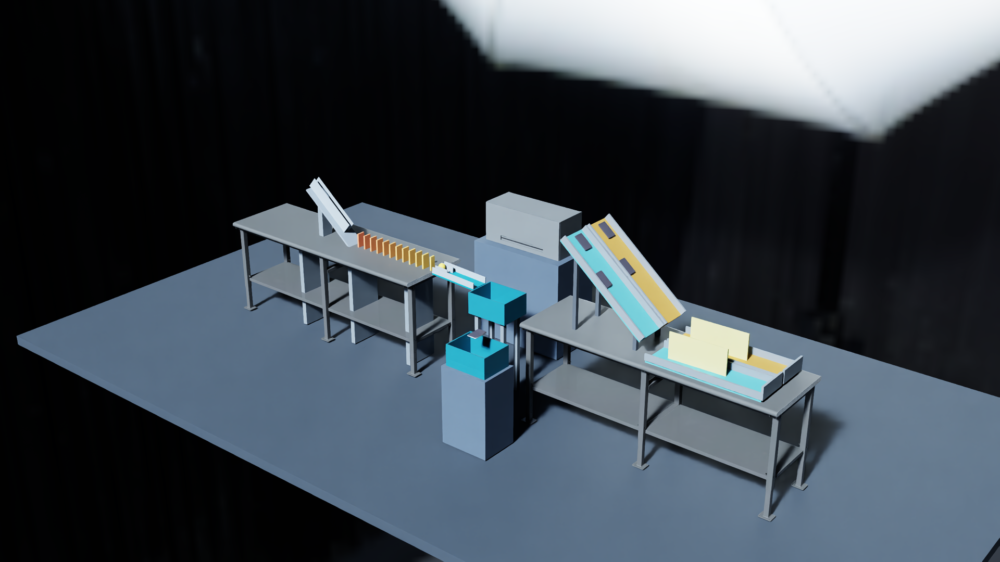

# Multi-source kinetic asset gallery

[Watch the 66-second film](../../docs/media/kinetic-asset-gallery-1080p30.mp4) · [Frame/time edit map](film-map.json)

[Download continuous native sources](https://github.com/ros-claw/simscene/releases/download/v0.2.0-dev.1/kinetic-gallery-native-sources.zip)
from the V2 preview release. The current film uses newly synchronized source
recordings. Its main run, matched stopping control and short changed-length
capture passed again; historical rebuild/long-variant identities remain in the
[validation summary](validation-summary.json).

Four physical exhibits share one 60-second main run: a scanned product starts a
12-domino/ball handoff, four imported notebooks follow separate gravity lanes,
a preserved native cabinet hinge opens and closes under a declared drive, and
a notebook passes through a generated receiver's opening and settles.



The cabinet is an **independent scheduled PhysX mechanism**. The exhibition is
not presented as one passive whole-scene causal chain. The product/domino/ball
path has its own frozen contact order and missing-middle control.

| Role | Selected source | Preparation |
|---|---|---|
| Visual workbenches | NVIDIA USD Search / Isaac PackingTable bare-table member | Explicit measured static collision proxies; individual asset license unresolved |
| Moving product | GSO standard GLB fondant box | Actual imported geometry, 120 mm, experimental 0.12 kg |
| Moving notebooks | ABO GLB `B01DN8TB5U` | Five separately observed instances, 150 mm, experimental 0.12 kg each |
| Native hinge | USDCraft `ds_R021_02` | Preserved two-link/single-DOF graph, native mass/collision/friction |
| Guide and receivers | Reviewed Sand3D trusted templates | Normally prepared static guide and open five-wall containers |
| Studio illumination | Poly Haven `studio_small_03`, 1k EXR | Self-contained light-only USD package |

The source/preparation lock contains seven deduplicated roles, not seven full
asset libraries. Models, textures and local runtime paths are not distributed.
See [asset terms](../../OPEN_SOURCE_NOTICES.md) and [validation scope](../../docs/validation/catalog-capabilities.md).

## Rebuild a new run

Install the project, USD bindings and FFmpeg on the simulation host. Configure
Isaac and explicitly install/probe the isolated GLB decoder as described in
[preparation](../../docs/asset-catalog.md). For both generated templates,
configure the separately reviewed [Sand3D runtime](../../docs/asset-generation.md)
in your V2 configuration. No backend is installed automatically.

Use an owned output directory outside the checkout:

```bash
export SIMSCENE_HOME=/your/new-gallery/state
export SIMSCENE_CACHE=/your/selected-source-cache
export SIMSCENE_V2_CONFIG=/your/gallery-v2.json
export SIMSCENE_ISAAC_PYTHON=/your/isaac-sim/python.sh

python3 experiments/acquire_recipe_assets.py examples/kinetic_asset_gallery/assets.lock.json \
  --cache "$SIMSCENE_CACHE" --catalog-output /your/new-gallery/bindings.json
python3 experiments/apply_scene_recipe.py examples/kinetic_asset_gallery/recipe.json \
  --scene-id kinetic_gallery --asset-catalog /your/new-gallery/bindings.json \
  --asset-lock examples/kinetic_asset_gallery/assets.lock.json \
  --save-directory /your/new-gallery/applied
python3 experiments/freeze_recipe_case.py examples/kinetic_asset_gallery/case.json \
  --bindings /your/new-gallery/bindings.json \
  --asset-lock examples/kinetic_asset_gallery/assets.lock.json \
  --output /your/new-gallery/frozen-case.json
simscene run --scene kinetic_gallery --steps 3600 --seed 42 \
  --case /your/new-gallery/frozen-case.json
simscene verify --run /actual/returned/run-directory
```

`case.json` contains whole-value role markers. Freeze a **new** case against the
rebuilt content-checked bindings; do not copy an old prepared hash or verdict.
The public recipe includes four native 1920×1080/30 fps cameras and explicitly
raises its recording-camera allowance to four. The fixed overview and hinge
camera cover 60 seconds; chain and receiver detail windows cover 12 and five
seconds. Rendering is a substantial separate cost. For a physical rehearsal,
remove camera add-operations from a copy of the recipe before applying it.

The main case checks actual imported-body mappings, direct contacts, all
12 dominoes tipping, ball containment/settling, independent routing bodies,
measured native joint coordinates and container passage. It reads saved
observations and does not trigger or repair mechanisms.

## Missing-middle control

Create a separate scene from the same operations with only `chain_domino_06`
removed. Keep every other physical object, drive schedule, prepared identity,
seed and all 3,600 steps identical. Use the **same frozen case bytes**. The
case explicitly allows render-only differences, so diagnostic cameras may be
omitted; the verifier independently rejects physical schemas in those deltas.

The whole positive gallery case should fail on the broken chain. Use the MCP
`run_verify` with `case_type: handoff_chain`, `mode: missing_middle` and the
positive `reference_job_id` to verify the expected negative. Upstream movement
must remain while downstream tiles and the ball stay inactive. A stopped
upstream source is not a valid counterfactual.

## Change the guide length

The included `length_variant.py` uses local orientation and a length delta,
without copying a full scene of new coordinates. Generate a new
`guide_plate_v1` with length 0.65 m, unchanged width 0.18 m and thickness
0.015 m. Normally prepare it as `static_fixture_v1` with its corresponding
0.65 m box proxy and measured support region. Preserve the completed job JSON.

```bash
python3 examples/kinetic_asset_gallery/length_variant.py \
  examples/kinetic_asset_gallery /your/longer-preparation-completed.json \
  /your/new-length-variant
```

The script holds the entry fixed, moves the guide centre and side walls by
half the extension, and moves receiver/supports horizontally by the full
extension. Other physical properties and drive schedules remain unchanged.
It exports new ordinary operations, source locks and case markers. Apply,
freeze and run that new recipe as above. Compilation alone reports
`physical_verification: not_run`; it cannot establish the new result or token
savings. This measured example supports shallow slopes and bounded extensions,
not arbitrary automatic assembly.
