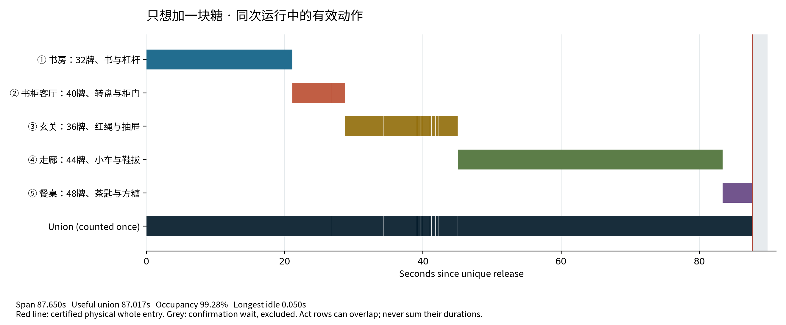

# 只想加一块糖

[55 秒多机位主片](../../docs/media/only-one-sugar-public-55s.mp4) · [20 秒慢动作特写](../../docs/media/only-one-sugar-details-20s.mp4) · [20 秒断绳对照](../../docs/media/red-rope-causal-comparison-20s.mp4)。新增近景和跟拍来自同次原始物理记录的准确刚体姿态重渲染，新增物理步数为零；逐帧出处随交付保留。原 106 秒连续原速版保留不变。下一件作品的[制作入口](../../docs/passive-production.md)区分复现、修改和原创路径。

本轮八项正式物理任务及独立汇总已通过，工程新目录重跑与默认 v43 MCP 交接已完成。见[验证范围](../../docs/validation.md)和[验收指纹](acceptance-provenance.json)。工程重跑曾发生外层会话中断；原 worker 完成同一个 job 后经单独冻结的恢复流程验收，旧外层路径未改记为通过。

一次释放初始球，让书房、客厅、玄关、走廊和餐桌依次接力，最后把茶匙中的方糖倒进空杯。五组实际刚体骨牌为 32/40/36/44/48，共 200 张。场景含 746 个对象、288 个动态体、82 个被动关节；绳段、书本和辅助结构不计入骨牌数。

这些普通操作在 Agent 完成构建和诊断迭代后，从真实 MAIN1 运行导出，没有作为答案交给构建 Agent。`recipe.json` 的 748 条操作重建物件及观察、摄影配置；`assets.lock.json` 固定七个在线来源的所选文件，共 349,509,053 字节。十一处视觉实例共享这些来源。模型和贴图未放进此目录。



该图只展示已独立验收的 MAIN1：主链 87.65 秒，净有效动作 87.0167 秒。重叠分幕不能相加，灰色稳定确认等待不计入。另有 [SVG](main1-activity.svg)、[PDF](main1-activity.pdf) 和 [图的来源指纹](main1-plot-provenance.json)。它不是整套八项验收证书。

在 GPU 仿真主机上安装支持有限 D6 与 `simscene.passive_network.v3` 的当前 v43 功能及 USD Python 绑定，准备兼容 Isaac Sim 6.2 的运行环境与启用 zscale 的 FFmpeg，再从仓库根目录执行：

```sh
export SIMSCENE_HOME="$PWD/state/whole-home-sugar-reproduction"
export SIMSCENE_ISAAC_PYTHON="/data/omniverse/isaac-sim-6.2.0/python.sh"
export SIMSCENE_PHYSICS_DEVICE="cpu"
python3.10 experiments/acquire_recipe_assets.py examples/whole_home_sugar/assets.lock.json --cache "$SIMSCENE_HOME/cache" --catalog-output /tmp/whole-home-sugar-assets.json
python3.10 experiments/apply_scene_recipe.py examples/whole_home_sugar/recipe.json --scene-id sugar_example --asset-catalog /tmp/whole-home-sugar-assets.json --save-directory "$SIMSCENE_HOME/recipe-main"
simscene run --scene sugar_example --steps 7800 --seed 0 --case examples/whole_home_sugar/case.json
```

CLI 命令会等待 worker；若改用已安装 MCP 启动，取得 `job_id` 后用 `job_status` 等到 `completed`。再对返回的实际运行目录执行：

```sh
simscene verify --run /absolute/path/to/completed/run --type passive_network --mode positive
```

这个命令检查 stock 被动网络条件。完整作品验收还包括独立物性、绳轮接触、辅助结构、原始记录完整性、入杯几何、有效动作时钟、三种负对照及工程重跑；不能把 worker 正常退出或一次 stock 检查当作整套通过。

`variant-20cm-operations.json` 包含七条普通更新，实施预先声明的十一项向量修改：杯子和茶匙组件沿 X 移动 −0.20 米，同时修正同一个托块的斜连杆、输出指、支承间隙及糖块装载位置。它并非整套末端的纯平移。对已有主场景应用：

```sh
python3.10 experiments/apply_scene_recipe.py examples/whole_home_sugar/variant-20cm-operations.json --scene-id sugar_example --save-directory "$SIMSCENE_HOME/recipe-variant"
simscene run --scene sugar_example --steps 7800 --seed 0 --case examples/whole_home_sugar/case.json
```

本机已用既有所选资源完成主配方及变体的配置重建和 USD 导出：四个配置域与对象顺序完全匹配原场景或其十一项修改。这两次操作属于静态重建检查；可编辑工程另在新目录完成了完整物理重跑和原独立 F9/K6 验收，实际记录见报告。

物理近似保留在配方中：在线资产均为明确的视觉附件，碰撞和指定质量来自对齐的刚体代理。功能柜门和接糖杯是自建的实体几何；装饰柜体、旧红杯和其他摆设不冒充传力物件。绳为 55 个胶囊、54 个有限 D6 和两个端部连接组成的被动离散模型；自由滑轮有实际轮芯、法兰与转轴。这不是经过实物标定的纤维弯曲／扭转或张力模型。小车的理想导轨、载荷压块、碰撞排除及质量参数均显式保留，不能额外计作家居类别或有效动作。

资源锁保留来源、指纹及依赖状态。部分 MDL 名称由兼容的 Isaac SDK 提供，普通 USD 环境的同名解析提示不能替代 SDK 中的实际依赖检查。所选第三方资产许可仍标为 `UNVERIFIED`；此处只保留引用与操作，未授予模型或贴图的再分发许可。
