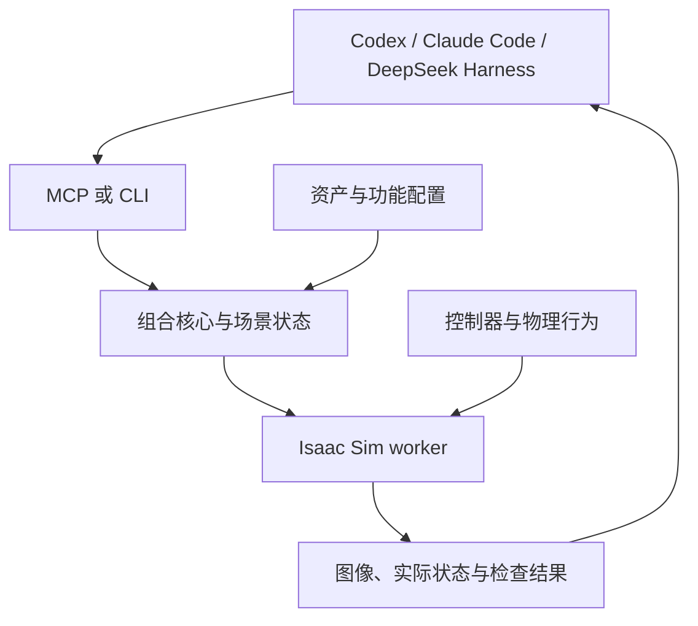

我建议把这个项目做成 **SimScene：面向 Agent 的物理场景搭建插件**，建议仓库名为 `ros-claw/simscene`。

它的核心能力可以定义为：

> **让 Agent 用自然语言选择和组合仿真资产，配置物理与行为，运行后观察结果，并继续修改场景。**

实现上采用 **共享 Python 核心 + MCP 工具 + 少量通用 skill + 参数化场景配方**。第一版实装 Isaac Sim 后端，用你提出的“三种机械臂沿传送带动态分拣”作为完整验收案例。

按照你最后说的“发给 Codex 去做、去验证”，我已经整理好一份可以直接交给本地 Codex、放进新仓库的完整实施说明：
/code/rosclaw/simscene/SIMSCENE_IMPLEMENTATION.md

文档包含架构、工具接口、场景格式、三臂选型、三种客户端接入、开发顺序、验收条件和官方资料。本轮完成的是调研、实施设计与审阅；**插件代码和三臂 GPU 仿真尚未执行**，文档中的成功率等数字是待实测的验收目标。

下面把关键判断和实施方案展开说明。

## 一、调研后的关键判断：复用 NVIDIA 已有能力，集中实现“组合与修改”

### NVIDIA 已经在做与你的方向很接近的东西

Isaac Sim 6.2 已经随安装包提供 Agent skills，包括：

- `isaac-sim-orchestrator`：将自然语言请求组织为可运行仿真。
- `spatial-reasoning`：处理单位、包围盒、摆放顺序、朝向等空间问题。
- `usd-pipeline`：资产发现、测量与替换。
- `physics-simulation`：刚体、碰撞、关节、接触材质等配置。
- `manipulation-ik`：机械臂运动学与抓取坐标系。
- 远程操作、渲染、相机配置和结果检查等工作流程。[Isaac Sim Documentation](https://docs.isaacsim.omniverse.nvidia.com/6.2.0/development_tools/agent_skills.html?utm_source=chatgpt.com)

因此，这个项目可以直接利用官方积累的 API 用法和工作流程。**我们要把这些能力组织成一个安装方便、接口稳定、能够持续编辑场景的插件，并用真实运行检验它。**

这里也需要修正一下“skill 不够”的理解：skill 可以携带脚本和参考资料，能力并不天然弱。真正需要工程实现的是资产适配、场景状态、组合操作、仿真执行和反馈。插件适合作为这些能力的分发单元，skill 则负责教 Agent 如何使用它们。

### SimReady Central 和资产数据集处于不同层

你前面发的两个链接，放进这个方案后可以这样理解：

| 组件 | 在项目中的作用 |
|---|---|
| `nvidia/simready-assets` | 一个具体的资产来源，提供模型、元数据和相关文件 |
| SimReady Central | 连接多个贡献者数据集的发现入口和共享索引 |
| SimScene | 选择资产、理解可用能力、组合成场景、配置行为并验证运行 |

官方文档明确说明，资产由贡献者自己的 Hugging Face 数据集托管和版本管理，Central 将这些数据集连接起来，方便发现。**第一版接入现有索引即可。**[Omniverse SimReady](https://docs.omniverse.nvidia.com/simready/latest/simready-central.html?utm_source=chatgpt.com)

### 三臂场景也有可以复用的官方基础

Isaac Sim 6.2 的状态机教程已经包含 **UR10 从运动传送带取 KLT 箱、必要时翻转、再码垛**的例子。它提供了观察、控制器和动作命令之间的组织方式，可以用来验证环境和借鉴控制流程。[Isaac Sim Documentation](https://docs.isaacsim.omniverse.nvidia.com/6.2.0/state_machine_tutorials/tutorial_state_machines.html?utm_source=chatgpt.com)

我的版本建议是：**新项目默认锁定 Isaac Sim 6.2.0 GA + PhysX**。当前官方 release 列表将 6.2.0 标为 GA，7.0.0a1 为预发布；已有 6.1 环境可以单列兼容档。还要注意，6.2 已移除 Cortex，实施时应使用对应版本的状态机与控制示例。[GitHub](https://github.com/isaac-sim/IsaacSim/releases?utm_source=chatgpt.com)

---

## 二、把你的一句话优化成什么样

我建议用这一版作为用户实际输入：

> **用现成仿真资产搭建一座明亮、精致的智能分拣工作站，让三种不同型号的机械臂沿一条持续运行的传送带错位协作，分别将不断进入的红、绿、蓝三类小件抓取并放入对应料箱，呈现双指夹持和吸盘搬运两种动作，加入补料滑槽、末端漏料回收区、跟随真实设备状态变化的指示灯与分拣计数，以及全景、俯视和抓取特写相机，自动运行并检查结果，保存可继续编辑的场景和一段能够清楚看见真实抓取过程的演示视频。**

这句话保留了你的核心意图，也给 Agent 足够的视觉和动态目标。

场景效果可以这样设计：

- 三个工位沿输送方向错开，中间一台放在传送带另一侧，让画面有纵深。
- 红、绿、蓝工件对应不同机械臂、料箱和工位灯。
- 来料、追踪抓取、转运、落箱同时发生，形成持续变化的画面。
- 未抓到的物体继续向末端运动，落入实体回收盘。
- 指示灯显示真实状态，例如等待、追踪、夹持、转运和故障。
- 固定全景负责完整展示，特写负责看清夹爪闭合、物体抬升和释放。

**第一版的动态丰富度主要来自真实物理过程和三个工位的并行活动。**在抓放稳定后，再增加圆柱件、纸盒、随机朝向和更密集的来料。

另外，我建议第一版明确采用 `oracle_state`：控制器直接读取仿真中的类别、位置和速度。这样可以集中验证你关心的场景组合能力、控制适配和物理运行。视觉识别可以作为后续独立能力加入。

## 三、怎样做到“很多场景，少量 skill”

关键是把知识、操作和场景数据分开。

### 1. 一个主 skill，教 Agent 通用工作方法

例如 `build-scene`，只教它：

1. 检查环境和支持的能力。
2. 搜索资产，读取尺寸、单位、部件与关节。
3. 将用户要求转换成对象、关系和行为。
4. 构建场景并检查布局。
5. 运行，读取画面和状态。
6. 根据具体问题修改。
7. 保存可重建的结果。

主 skill 不需要写死“三台机械臂”“红绿蓝分拣”“某个传送带型号”。

### 2. 通用组合操作负责实际执行

第一版应提供这类操作：

| 操作类别 | 例子 |
|---|---|
| 实例与基础几何 | 导入资产、创建刚体方块、复制实例 |
| 空间组合 | 放到支撑面、对齐、朝向、按行列或路径排列 |
| 关系与连接 | 保持净空、固定连接、创建基础关节 |
| 功能绑定 | 绑定机械臂控制配置、传送带行为、投料流 |
| 观察与展示 | 放置相机、瞄准目标、配置灯光 |
| 编辑与检查 | 移动物体、替换资产、重算关系、检查可达性 |

“沿传送带布置三个工位”可以是一个可复用的组合宏。它最终展开为机器人实例、位置、朝向、可达区域和料箱关系。

**起步阶段用锚点、候选位置、运动学和碰撞筛选就够了。**遇到无解的布局，返回具体原因，让 Agent 调整。

### 3. 不同场景主要变成配方数据

例如：

- 三臂分拣线。
- 单臂工作台和两排料盒。
- 多米诺排列。
- 斜坡、滚动物体和收集盒。
- 多相机围绕一个机械装置观察。

只要所需物理机制已经支持，新增场景主要是重新组合对象、关系和行为。

当用户要求柔性布料、流体或者一种新的机器人执行方式时，再扩展对应行为或后端。**场景种类与 skill 数量不需要一一对应。**

## 四、插件架构：Agent 管组合，控制器管每个物理步

建议采用下面的结构：



这里最重要的职责划分是：

**Agent 负责较慢的决策。**它选择资产、安排位置、选择控制器、修改参数、解释失败并修复场景。

**仿真进程负责实时执行。**传送带、物体生成、机械臂跟踪、夹持和状态机都在 worker 中运行，每个物理步由控制器计算。

这个结构可以避免把机械臂运动速度绑定到大模型响应速度。

### 核心要维护一份明确的场景表示

我建议分成两个阶段：

- **SceneIntent**：允许表达“选一个支持吸盘的机械臂”“料箱放在容易到达的位置”等意图。
- **ResolvedSceneSpec**：已经确定具体资产、单位、坐标、对象 ID、控制配置和行为参数。

用户说“把蓝色料箱挪到另一边”，插件应当更新对应对象、重新检查可达性和路径，然后继续运行。它需要稳定对象 ID 和场景版本，才能可靠地修改已经搭好的场景。

### 资产要有“功能配置”

资产目录中有某个机器人，仍需要确认它能被当前控制器正确驱动。

因此，一个机械臂的功能配置至少应包含：

- 资产路径与版本。
- 关节名称、限位和默认姿态。
- 夹爪关节与开合范围。
- 末端坐标系、工具中心点和偏移。
- 控制器配置。
- 实测支持的运行环境。

传送带也要记录真实带面、输送方向、可用范围和速度控制接口。料箱要记录内部有效容积，而不只是外部包围盒。

**这些信息让 Agent 有依据地组合资产，也让插件能够解释为什么某种组合暂时不可用。**

## 五、三台机械臂怎么选，动态分拣怎么实现

### 推荐的旗舰组合

| 工位 | 机器人 | 搬运方式 | 分工 |
|---|---|---|---|
| 1 | Franka Panda | 双指接触夹持 | 红色工件 |
| 2 | UR10 | 吸盘 | 绿色工件 |
| 3 | Kawasaki RS007L + OnRobot RG2 | 双指接触夹持 | 蓝色工件 |

这些机械臂或组合资产可以在官方机器人目录中找到，外形也有明显区别。[Isaac Sim Documentation](https://docs.isaacsim.omniverse.nvidia.com/6.2.0/assets/usd_assets_robots_manipulator.html?utm_source=chatgpt.com)

**最需要提前验证的是第三台的控制配置。**当前 cuMotion 配置文档提供 Franka、UR10 的预配置加载方式，其他机器人需要匹配自己的 URDF、XRDF、关节映射和工具坐标系。[Isaac Sim Documentation](https://docs.isaacsim.omniverse.nvidia.com/6.2.0/cumotion/tutorial_robot_configuration.html?utm_source=chatgpt.com)

我把这件事放进了开发第一阶段，避免最后才发现“模型摆上去了，但无法可靠抓取”。

如果 RS007L 的适配受阻，官方的 **UR10e + Robotiq 2F-140** 组合和抓放教程可以作为备用路径。届时应明确标注为“三种型号”的工程配置；三个品牌的展示配置要等 RS007L 实测通过后再发布。[Isaac Sim Documentation](https://docs.isaacsim.omniverse.nvidia.com/6.2.0/robot_setup_tutorials/tutorial_pickplace_example.html?utm_source=chatgpt.com)

### 传送带要真正作用于物体

官方 Conveyor 扩展可以给目标刚体表面创建输送功能，当前 Python 入口包括 `create_conveyor_belt`。实现时要把功能绑定到实际接触表面，工件通过接触随带运动。[Isaac Sim API](https://docs.isaacsim.omniverse.nvidia.com/6.2.0/py/source/extensions/isaacsim.asset.gen.conveyor/docs/index.html?utm_source=chatgpt.com)

最早的物理测试应该很简单：

> 一个方块落到带上，随带前进；带速改变时运动响应改变；到达末端后因重力落下。

这一关通过后，再加机械臂。

### 每台机械臂采用追踪抓放状态机

主要流程是：

1. 发现本工位负责的物体。
2. 预占目标，估计可抓取窗口。
3. 根据实际物体位置和速度计算拦截位置。
4. 进入预抓取姿态，跟踪目标下降。
5. 闭合夹爪或启动吸盘。
6. 确认真实抓持后抬升。
7. 转运至对应料箱，释放。
8. 检查器确认落箱并稳定，再计数。

调试时可以先停带抓取，最终验收要求连续输送。静态抓放控制器使用的一次性目标位置，需要扩展为移动目标跟踪。

### 双指和吸盘分别验证

双指夹爪依赖接触、摩擦和关节驱动。验收中应确认物体确实被夹住并抬起。

吸盘可以使用官方 Surface Gripper，它通过接近检测和带力限的约束模拟吸附。应记录实际抓持对象、力限、连接和释放状态。这个机制是明确声明的物理近似，可以用于本场景。[Isaac Sim Documentation](https://docs.isaacsim.omniverse.nvidia.com/6.2.0/robot_simulation/ext_isaacsim_robot_surface_gripper.html?utm_source=chatgpt.com)

三个工位首先使用尽量分离的工作区。若布局引入共享空间，再增加区域占用和让行机制；不能把三套独立控制器自动视为已经完成多臂协调。

## 六、怎样集成 Codex、Claude Code 和 DeepSeek Harness

建议 **共享后端、分别打包**。

| 宿主 | 接入方式 | 发布形式 |
|---|---|---|
| Codex | 同一 MCP server，加通用 skill | 当前 portable 插件格式，另提供 CLI 注册路径 |
| Claude Code | 同一 MCP server，加通用 skill | Claude 原生插件包 |
| DeepSeek Harness | 官方 MCP client 连接同一 server | Cordis 配置 patch，按需提供薄 bundle |

### Codex

当前官方插件文档使用 portable 格式，包括根目录 `plugin.json`、`mcp.json` 和 `skills/`。CLI 也提供直接注册 MCP 服务的方式。[OpenAI Developers](https://developers.openai.com/plugins/build/plugins?utm_source=chatgpt.com)

项目实现后，CLI 接入可以生成类似命令：

```bash
codex mcp add simscene -- /absolute/path/to/venv/bin/simscene mcp
codex mcp list
```

这里的 `simscene mcp` 是待实现的项目入口，绝对路径由安装器根据实际环境生成。

### Claude Code

独立生成一个包含 `.claude-plugin/plugin.json`、根 `.mcp.json` 和 `skills/` 的插件目录。开发验证可以使用：

```bash
claude --plugin-dir /absolute/path/to/simscene-claude-plugin
```

这些目录和加载方式都有官方支持。[Claude Code Docs](https://code.claude.com/docs/en/plugins/create?utm_source=chatgpt.com)

### DeepSeek Harness

官方已经提供 `@deepseek-ai/dsh-mcp-client`，可以接入 stdio 或 Streamable HTTP MCP 服务。第一版直接通过它连接 Python 核心即可。[GitHub](https://github.com/deepseek-ai/deepseek-harness/blob/master/packages/mcp/mcp-client/README.md?utm_source=chatgpt.com)

如果需要成为可安装的 Harness bundle，再提供声明 `dsh.bundle` 的 npm 包和对应 Cordis patch。场景逻辑仍然留在共享核心中。[DeepSeek Harness](https://deepseek-harness.github.io/deepseek-harness/en/develop/basic/publish?utm_source=chatgpt.com)

### 共同需要处理的运行问题

仿真启动、资产下载和长时间运行，都应该返回 `job_id`，再查询进度；一次实验另有独立 `run_id`。

MCP 服务本身保持轻量，工具发现时不启动 GPU 仿真。真正请求创建场景时才连接或启动 worker，后续调用复用同一个会话。

文档中也明确区分了三种状态：

- 已生成客户端配置。
- 已注册 MCP 服务。
- 已安装并实测原生插件。

支持矩阵必须写出实际完成到哪一步。

## 七、怎样验证“Agent 会组合”，以及“场景真的完成分拣”

这两件事要分别测试。

### 第一组：Agent 组合能力

用新的 Agent 会话、空场景和固定版本插件，执行以下任务：

1. 用推荐的一句话搭建三臂分拣。
2. 交换两台机械臂负责的类别。
3. 将一个料箱移到机械臂另一侧，重新检查可达性和路径。
4. 降低带速、增大投料间隔，确认实际运行发生变化。
5. 搭建一个没有提供完整配方的新组合，例如“单机械臂工作台、两排料盒和环绕观察相机”。

第五个任务尤其重要：**测试前冻结插件代码与主 skill，允许 Agent 生成新场景数据，不临时补专用 skill。**

每次都保存输入、工具调用、场景修改、实际检查结果和截图。这样才能知道插件提供的通用能力是否足以支持新的组合。

### 第二组：三臂物理任务验收

我在文档中提出了以下初始门槛。它们需要调试后冻结，再正式执行。

| 项目 | 建议验收条件 |
|---|---|
| 机器人 | 三台不同型号，每台都完成实际抓取和正确落箱 |
| 连续输送 | 正式抓取阶段带速非零 |
| 并行活动 | 存在三个工位同时处于取放循环的连续时段 |
| 样本 | 3 个种子，每次 60 个物体，每类 20 个，总计 180 个 |
| 成功率 | 每次运行整体 ≥90%，每台分别 ≥85% |
| 错箱 | 0；漏抓、掉落、超时计入失败 |
| 接触 | 无机械臂互撞、穿透工作台等未允许接触 |
| 重跑 | 至少 3 次从保存的初始场景重新运行 |
| 持续运行 | 额外运行 10 分钟仿真时间，记录资源和物料状态 |
| 录像 | 连续全景原片，必要时增加抓取特写 |

这套验收中的“成功”不能只看状态机进入 `DONE`。它至少应包含：

> 目标类别正确，有实际抓取证据，已经释放，物体处于正确料箱内部，并在约定时间内保持稳定。

### 物料统计必须闭合

每个物体拥有唯一 ID。任意时刻满足：

> **已生成 = 正确归箱终态数 + 错箱终态数 + 失败终态数 + 尚未进入终态的物体数。**

物体即使成功后仍留在箱里，也只计一次。抓取失败后重试，尝试次数另记；任务成功率仍以生成物体总数为分母。

正式验收的目标、类别映射、阈值和超时放在独立用例中，避免 Agent 修改场景时把验收要求一起改掉。

### 加三个负对照，确认检查器能识别失效

- 禁用某台夹爪，检查其搬运成功数是否出现预期下降。
- 停止某台机械臂的关节驱动，检查物体是否还会异常归箱。
- 将带速置零，检查物体是否仍持续受到原输送运动。

负对照观察到预期失效，才表示这项检查通过。

还有一个具体注意点：Claude Code 官方 plugin eval 当前默认会模拟 MCP，适合验证插件触发和调用参数。真实物理验收必须使用实际服务和 worker，并记录运行证据。[Claude Code Docs](https://code.claude.com/docs/en/plugin-evals?utm_source=chatgpt.com)

## 八、开发顺序：先解决关键适配，再扩大场景

我建议让本地 Codex 按下面的阶段推进。

| 阶段 | 工作 | 应交付的结果 |
|---|---|---|
| **P0 环境与风险** | 检查实际版本、官方 skills、运行 UR10 示例、验证第三机械臂配置 | 环境报告、实际日志、选型结论 |
| **P1 最小链路** | Agent 调用 MCP，导入资产、摆放、截图、运行落带测试、保存 | 一个真实客户端中的完整调用链 |
| **P2 通用组合** | 场景表示、关系、编辑、资产配置和检查 | 工作台与输送工位能生成并修改 |
| **P3 三机抓放** | 分别验证 FK、工具坐标、夹持和释放 | 三台各自完成静态抓放 |
| **P4 连续分拣** | 移动目标跟踪、工位协调、失败处理和独立计数 | 三臂不停带分拣 |
| **P5 Agent 与宿主** | 空场景生成、后续修改、干净安装、跨客户端测试 | 支持矩阵与工具调用记录 |
| **P6 展示与开源** | 灯光、镜头、视频、文档、发布 | 可安装、可重跑、可核验的版本 |

**P0 的第三机械臂验证和 P1 的真实调用链，是最值得优先完成的两件事。**前者尽早暴露控制适配风险，后者保证后续代码始终服务于 Agent 实际使用。

第一版的范围就限定在这一条链路：资产发现、通用组合、物理运行、观察修改、三臂验收和客户端安装。

## 九、开源交付应该长什么样

建议在 [ros-claw](https://github.com/ros-claw) 下独立创建 `simscene`，便于用户单独安装。

核心仓库内容包括：

- `src/simscene/`：共享核心、资产接口、组合、会话、MCP 和 CLI。
- `backends/isaac/`：实际仿真适配。
- `behaviors/`：输送、投料、追踪抓放。
- `verification/`：独立检查器。
- `skills/build-scene/`：通用主 skill。
- `profiles/`：已验证的机器人、夹具、传送带和运行配置。
- `recipes/`：可修改的场景配方。
- `integrations/`：各客户端配置和打包。
- `tests/agent/`、`tests/sim/`：组合与物理验收。
- `examples/three_arm_sorting/`：三臂示例与重跑说明。

自有代码可以考虑 Apache-2.0。资产继续遵循各自许可证，仓库保存来源、版本、下载方式和适配配置。官方资产目录中的不同资产本身也可能采用不同条款。[Isaac Sim Documentation](https://docs.isaacsim.omniverse.nvidia.com/6.2.0/assets/usd_assets_robots_manipulator.html?utm_source=chatgpt.com)

### 场景包和运行记录分开保存

场景包保存初始 USD、场景规格、资产锁和控制配置。

每次执行生成一个新的运行目录，保存：

- 唯一运行 ID、场景版本、seed 和实际环境。
- Agent 调用记录与场景修改。
- 物体和关节状态。
- 抓持、接触、释放、落箱事件。
- 验收结果和失败原因。
- 连续录像与重跑命令。

这样同一场景跑三个种子时，结果不会互相覆盖；后续编辑场景也不会改变旧报告的含义。

## 十、直接交给本地 Codex 的指令

把上面的实施文档作为附件，再附上这段话即可：

> 请读取随附的 ，在 `ros-claw/simscene` 实现 SimScene 仿真场景搭建插件。先检查组织内是否已有同名仓库和本机实际运行环境，再按照 P0–P6 推进。
>
> 第一版采用共享 Python 核心、MCP/CLI、一个通用搭建 skill 和参数化配方，实际后端使用经过本机验证的 Isaac Sim 支持档。优先复用 NVIDIA 官方 skills、资产和状态机示例。
>
> 先完成一个真实 Agent 通过插件搭建、运行、观察和修改场景的完整链路，再完成三种机械臂沿连续传送带分拣的演示。机械臂资产、控制模型、工具坐标和夹持机制分别验证。
>
> 正式验收前冻结核心、行为注册表和独立测试用例。保存每次运行的输入、配置、日志、物理状态、结果和连续录像。新增组合测试允许生成新场景数据，不临时修改核心或增加专用 skill。
>
> 分别报告 Codex、Claude Code、DeepSeek Harness 的实际接入与运行状态。缺少某项运行条件时，继续完成其余可执行工作，并准确标注 BLOCKED 或 NOT RUN。
>
> 最终提交可安装源码、场景包、独立运行记录、验收报告、演示视频和干净环境重跑说明，逐项对应文档中的完成标准。
